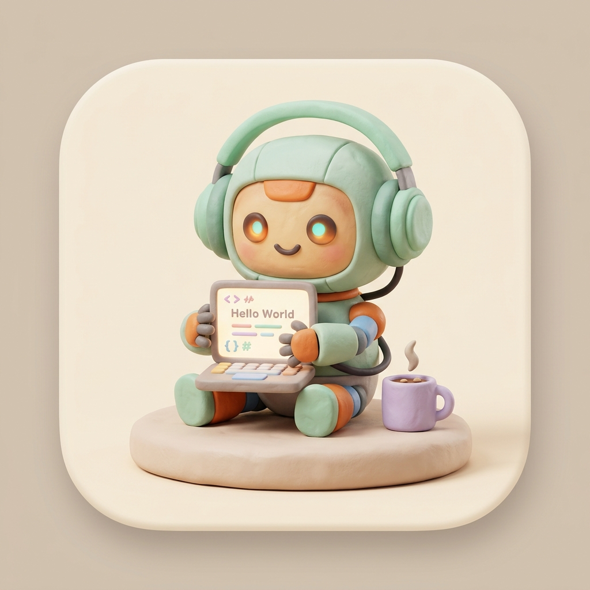

<p align="center">
  
</p>

<h1 align="center">🎮 Antigravity Monitor</h1>

<p align="center">
  <b>Pixel-Art Game Dev Studio Visualizer & Mission Control for Autonomous AI Coding Agents</b>
</p>

<p align="center">
  <a href="https://agy-monitor.surge.sh/downloads/AntigravityMonitor-macOS-Universal.dmg"></a>
  <a href="https://agy-monitor.surge.sh"></a>
  <a href="https://github.com/nconghau/AntigravityMonitor/stargazers"></a>
  <a href="LICENSE"></a>
</p>

---

## 🌟 Giới Thiệu (Overview)

**Antigravity Monitor** biến các tác vụ coding ngầm của **Google DeepMind Antigravity** thành một **Studio Game Dev 4 phòng isometric** sống động ngay trên máy tính của bạn:

* 💻 **Dev Lab (Office)**: Bot đang gõ code 120 WPM với âm thanh phím cơ mechanical cực đã tai.
* 🍳 **Kitchen & Cafe Bar**: Bot nhâm nhi espresso hoặc nạp pizza khi vừa xong task.
* 🛋️ **Studio Lounge**: Bot ngả lưng sofa nghe Lo-fi cùng **Mèo Bơ Mascot** 🐱.
* 🛏️ **Sleep Pod (Phòng Ngủ)**: Bot ngủ ấm nạp lại pin với hiệu ứng `💤 Zzz` lơ lửng.

<p align="center">
  
</p>

---

## ✨ Điểm Nổi Bật (Key Features)

* 🎯 **Vibe Coding Sprint Tracker (Phím `T`)**: Hẹn giờ đếm ngược tối đa 4 task lớn (VD: Đặt hàng CRM + Web + API đến 16:30), kèm thanh tiến độ sinh động, gia hạn nhanh +15m/+30m, chuông chúc mừng khi hoàn thành và chuông nhắc khi hết giờ để bạn kịp chốt task làm việc khác.
* 🎭 **14 Nhân Vật Chibi 3D Độc Bản (Playful UI Style)**: Mỗi agent được gán một nhân vật 3D mềm mại, biểu cảm dễ thương, tự do di chuyển và tương tác sinh động.
* ⚡ **100% Live Sync & DOM Diffing Không Chớp**: Cập nhật in-place từng bot theo ID mượt mà 60 FPS, không bao giờ nhấp nháy hay reload màn hình.
* 🛡️ **Anti-Hang Watchdog Tự Động**: Nhận diện thông minh và giải phóng ngay các job đã hoàn thành hoặc chạy quá lâu, không lo bị kẹt trạng thái processing.
* 🌐 **Hỗ Trợ Song Ngữ Anh / Việt (Bilingual EN / VI - Mặc định tiếng Anh)**: Tự động ghi nhớ tùy chọn ngôn ngữ, chuyển đổi 1-click tức thì toàn bộ giao diện, modal, dialog nhân vật và tooltip không cần reload.
* 📻 **Lo-fi Jukebox Ưu Tiên Nguồn Nhạc Việt Nam**: Mặc định tuyển tập giai điệu Việt Nam ấm áp (Cà phê sáng Sài Gòn, Hà Nội mùa thu mưa phùn, Đàn tranh & sáo trúc ngũ cung, Radio trực tuyến) tự sinh 100% offline qua Web Audio API cùng hiệu ứng pháo hoa Confetti và tiếng gõ phím cơ.
* 🎨 **Studio Customizer Hub (Phím `C`)**: Tự do đổi 6 theme màu Playful, thêm nhạc MP3 stream/upload từ máy tính, và tự tạo Bot AI riêng.
* 🩺 **Bác Sĩ Cấu Hình (Auto-Diagnostics)**: Quét tự động `~/.gemini/antigravity/brain`, cảnh báo trạng thái và hỗ trợ tạo thư mục mẫu chỉ với 1 click.

---

## 🚀 Tải & Chạy Ứng Dụng (Download & Quickstart)

👉 **Trang chủ giới thiệu**: **[https://agy-monitor.surge.sh](https://agy-monitor.surge.sh)**

### 🍏 macOS (Universal: M1/M2/M3/M4 & Intel)
1. **Tải bộ cài trực tiếp (Tốc độ cao)**:
   * 💾 **[AntigravityMonitor-macOS-Universal.dmg](https://agy-monitor.surge.sh/downloads/AntigravityMonitor-macOS-Universal.dmg)** *(12 MB)*
   * 📦 **[AntigravityMonitor-macOS-Universal.zip](https://agy-monitor.surge.sh/downloads/AntigravityMonitor-macOS-Universal.zip)** *(12 MB)*
2. Kéo `AntigravityMonitor.app` vào thư mục `/Applications`.
3. **Mở lần đầu (Sửa lỗi Gatekeeper macOS)**:
   ```bash
   xattr -cr /Applications/AntigravityMonitor.app
   ```

---

### 🪟 Windows (Chạy dạng Desktop App Độc Lập)
* **Khởi chạy tức thì với MS Edge / Chrome App Mode (Không thanh viền URL)**:
  Mở PowerShell trong thư mục dự án và chạy:
  ```powershell
  Start-Process msedge.exe -ArgumentList "--app=file://$PWD/app.html", "--window-size=1200,800"
  ```
* **Cài đặt dạng PWA**: Mở file `app.html` trong Edge/Chrome > Bấm biểu tượng **Install Antigravity Monitor** ở thanh địa chỉ để ghim icon ra Desktop và Windows Taskbar.

---

### 🐧 Linux (Ubuntu, Debian, Fedora, Arch)
* **Chromium App Mode**:
  ```bash
  chromium --app="file://$(pwd)/app.html" --window-size=1200,800
  ```
* **Python Webview Native Window (Siêu nhẹ)**:
  ```bash
  pip install pywebview
  python3 -c "import webview; webview.create_window('Antigravity Monitor', 'app.html', width=1200, height=800); webview.start()"
  ```

---

## 🌐 Tự Deploy Miễn Phí Lên Surge.sh

Bạn có thể tự host Studio riêng của mình trên domain cá nhân hoàn toàn miễn phí:

```bash
# 1. Cài đặt Surge CLI
npm install --global surge

# 2. Clone repository & vào thư mục
git clone https://github.com/nconghau/AntigravityMonitor.git
cd AntigravityMonitor

# 3. Deploy lên domain riêng của bạn
surge . --domain my-ai-studio.surge.sh
```

---

## ⌨️ Phím Tắt Tiện Lợi (Hotkeys)

| Phím | Chức năng |
| :---: | :--- |
| **`C`** | Mở **🎨 Studio Customizer** (Đổi Theme màu, Nguồn nhạc & Tạo Bot) |
| **`H`** | Chuyển đổi giữa **🏡 2D Studio 4 Phòng** và **🏢 List Dashboard** |
| **`J`** | Bật / tắt menu **📻 Lo-fi Jukebox** |
| **`D`** | Mở bảng **🩺 Bác Sĩ Cấu Hình (Auto-Diagnostics)** |
| **`U`** | Xem **🧠 Quota Còn Lại & Model Hub** (Gemini, Claude, GPT-OSS) |
| **`S`** | Xem chi tiết từng step thực thi của Agent đang chọn |
| **`R`** | Refresh đồng bộ Live Data ngay lập tức |
| **`T`** | Đổi nhanh preset Theme màu |
| **`F`** | Bật / tắt **⚡ Fever Mode** (Gõ phím 100 WPM cho toàn bộ bot) |
| **`M`** | Bật / tắt âm thanh hiệu ứng (SFX) |
| **`Esc`** | Đóng popup hoặc thoát zoom phòng |

---

## ⌨️ Phím Tắt Tiện Lợi (Keyboard Shortcuts)

| Phím | Chức Năng |
|---|---|
| `T` | 🎯 Mở / Đóng **Vibe Coding Sprint Tracker** (Đếm ngược mục tiêu tối đa 4 task lớn) |
| `R` | 🔄 Ép buộc làm mới dữ liệu & trạng thái Agent tức thì |
| `H` | 🏡 / 🏢 Chuyển đổi giữa chế độ **Studio 4 phòng** và **Dashboard danh sách** |
| `U` | 🧠 Mở bảng xem Models AI & % Quota còn lại |
| `J` | 📻 Bật / tắt Jukebox menu nhạc Lo-fi & Acoustic Việt Nam |
| `C` | 🎨 Mở Studio Customizer Hub (Đổi theme màu, nhạc, bot) |
| `S` | 🔍 Xem chi tiết các bước (Steps) của bot đang chọn |
| `D` | 🩺 Chạy chẩn đoán hệ thống (Diagnostics) |
| `Esc` | ✕ Đóng nhanh modal đang mở |

---

## 🛠️ Biên Dịch Mã Nguồn macOS (Build from Source)

Ứng dụng kết hợp giữa **SwiftUI / AppKit** (native MenuBar) và **HTML5 / Web Audio** trong `WKWebView`:

Mỗi bản phát hành dùng một version riêng trong `VERSION` và không ghi đè các bản đã build:

```bash
# Xem version hiện tại
cat VERSION

# Build theo VERSION (ví dụ 2.0.0)
./scripts/build-version.sh

# Build version mới; thư mục releases/v2.1.0 sẽ được tạo riêng
./scripts/build-version.sh 2.1.0
```

Kết quả được lưu tại `releases/v<version>/`, gồm app Universal, file ZIP và `build-info.txt`. Script sẽ dừng nếu version đã tồn tại để tránh ghi đè lịch sử build. Muốn cài một bản cụ thể vào Dock/Applications:

```bash
ditto releases/v2.1.0/AntigravityMonitor.app /Applications/AntigravityMonitor.app
open /Applications/AntigravityMonitor.app
```

---

## 📄 License

Phát hành dưới giấy phép **MIT License**. Tự do sử dụng, chỉnh sửa và đóng góp cho cộng đồng.

<p align="center">
  Phát triển với ❤️ cho cộng đồng AI Developers bởi <a href="https://github.com/nconghau"><b>@nconghau</b></a>
</p>
